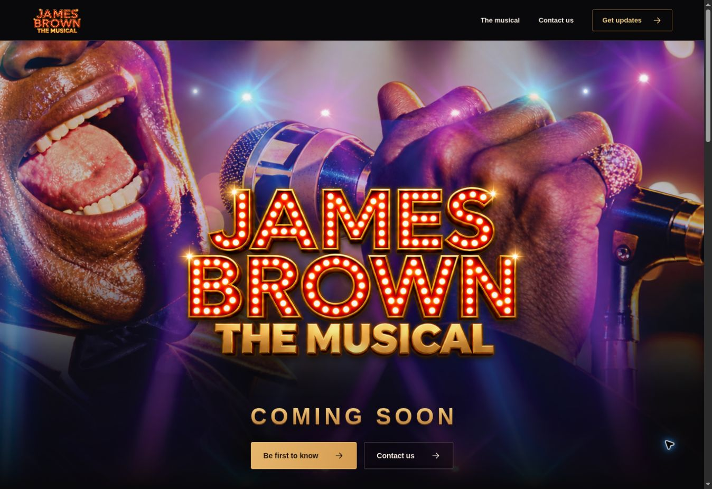
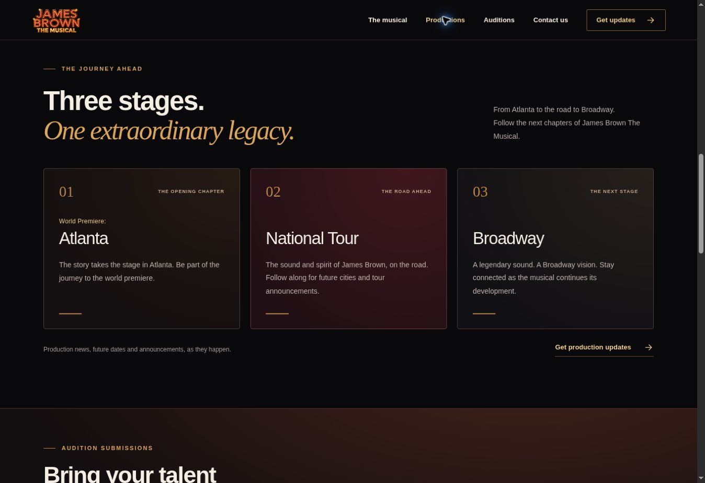
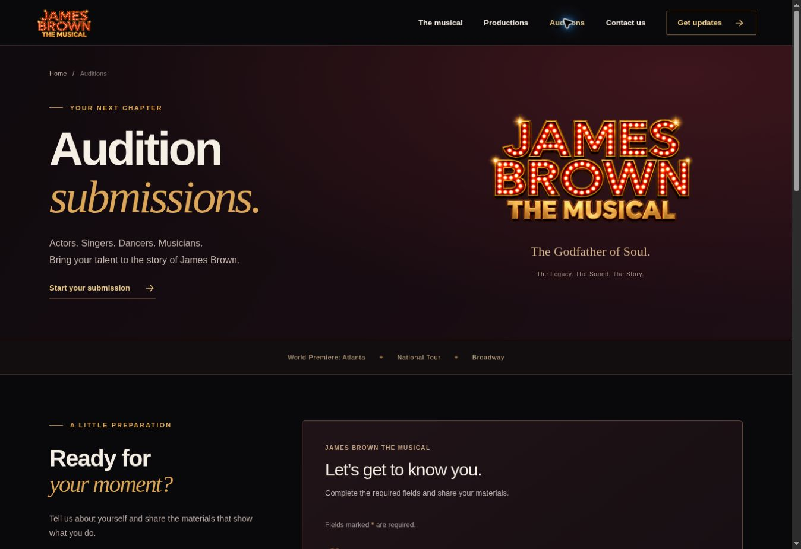
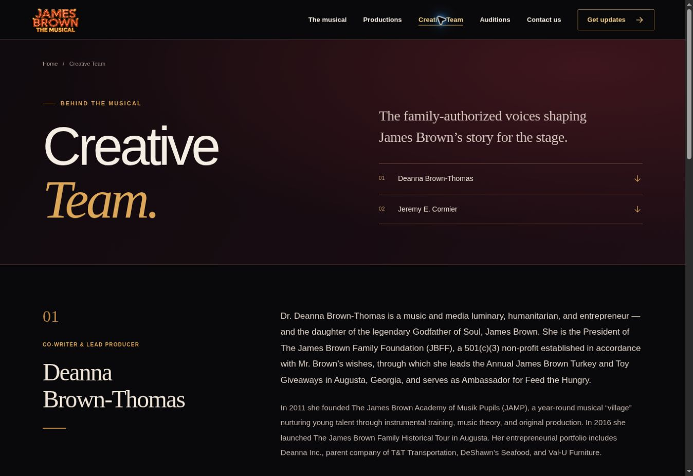
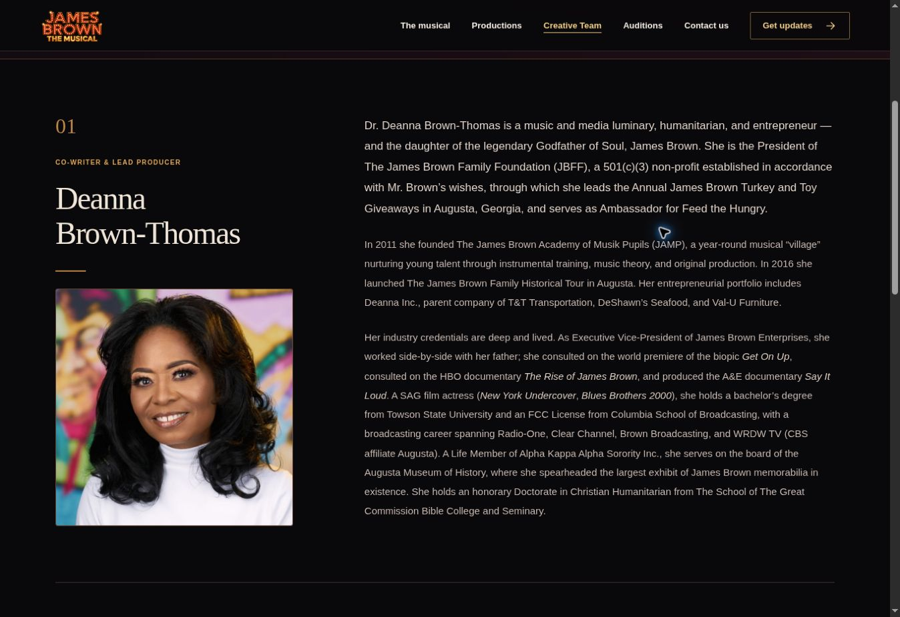
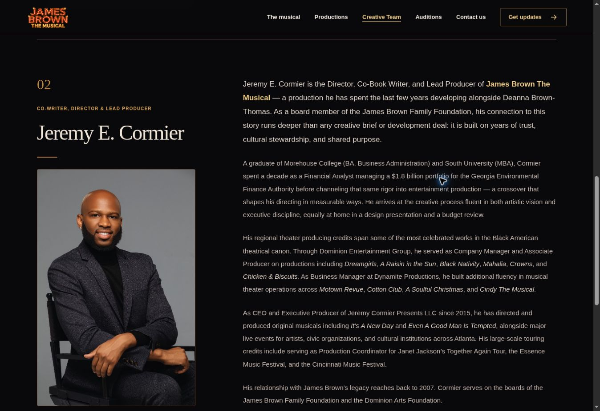

# James Brown The Musical

A responsive musical website built with the supplied James Brown artwork and marquee logo.

## Visitor features

- Branded hero and a brief introduction to the musical.
- Production highlights for World Premiere: Atlanta, National Tour, and Broadway.
- A `/creative-team` page with the complete supplied biographies of Deanna Brown-Thomas and Jeremy E. Cormier, linked from the main navigation, landing-page introduction, and footer.
- A dedicated `/auditions` page linked from the header, landing page, and footer.
- Audition submissions with contact details, performance interests, production preferences, a required headshot and PDF résumé, and optional experience and video link.
- More-information signup: optional first name, email, and explicit email consent.
- Contact form: name, email, inquiry topic, and message.
- Accessible validation, pending states, and confirmations after successful storage.
- A short notice explaining how submitted information is used.

## Submissions

The hosted D1 binding is `DB`. `information_signups` stores signups and consent records; `contact_messages` stores contact inquiries; `audition_submissions` stores audition details and casting consent. Files are stored in the private R2 binding `BUCKET`. Each headshot (JPEG, PNG, or WebP) and résumé (PDF) may be up to 5 MiB. The audition handler limits the total multipart body to 11 MiB; the framework limit is 12 MiB so valid uploads can reach that handler.

The production owner can review audition submissions at `/auditions/review`, with 25 submissions per page and protected download links. Both the page and file routes require a trusted Sites user identity whose verified email matches the explicit reviewer allowlist in `lib/audition-access.ts`. Granting general Site access does not grant reviewer access. No public endpoint lists submissions or exposes uploaded files. Signup and contact records remain available through the Site settings database viewer. Email notifications and automated campaigns are not configured.

The forms use server validation, origin checks, a honeypot, size limits, a durable rate limit, and a unique signup email index. Audition uploads also validate file signatures and use idempotency keys to avoid duplicate rows or materials on retries. Uploaded file contents are never served publicly; authorized downloads use attachment, no-store, and nosniff headers. Messages are plain text. Credentials and database access stay on the server.

## Design

The current hero uses `public/assets/james-brown-cover-updated.png`, with the supplied replacement marquee over the cover image. The standalone `public/assets/james-brown-marquee.png` appears in the header, footer, and audition hero. Brand accents use #DDA75A, #BC8645, and #F0CE88, with charcoal and deep red backgrounds. No performance dates or venues are assumed.

Creative Team content comes from the user-provided `creative-cast.html`, retained in `docs/source/creative-cast.html`. Its complete biographies, role labels, and inline emphasis are preserved. The supplied original portraits are `public/assets/deanna-brown-thomas.png` (800 × 800 pixels) and `public/assets/jeremy-e-cormier.png` (682 × 1024 pixels). The image files are copied byte for byte, with no pixel changes; responsive CSS displays each complete photograph at its natural aspect ratio without cropping. The source's sample cast cards contain placeholder biographies and are not published as cast announcements.

## Development and deployment

The canonical Site ID and bindings are in `.openai/hosting.json`. New Sites use private access by default. Preserve this identity and the existing audience on updates.

Source: `app/page.tsx`, `app/creative-team/`, `app/auditions/`, `app/globals.css`, `app/components/`, `app/api/`, `lib/`, and `db/schema.ts`.

Use the Sites workflow for dependency installation, preview, build, and publishing. `npm run db:generate` creates schema migrations. Existing migrations are immutable after deployment. Preview D1 data is local and is excluded from deployment.

## Verification

Verified with TypeScript checking, a production build, desktop and mobile browser checks at 390 and 320 pixel widths, successful signup and contact writes, duplicate signup handling, explicit consent records, invalid input, cross-origin rejection, payload-size limits, honeypot behavior, and rate limiting. Synthetic test records exist only in the local preview database.

Audition checks cover a successful browser submission, visible validation and preserved fields after an invalid upload, both files at exactly 5 MiB, signature/MIME/size rejection without storage writes, casting consent, sequential and concurrent idempotency, and protected download byte integrity. Reviewer access was tested locally using simulated trusted hosting headers; anonymous and unauthorized viewers were denied. Local test files and database state are excluded from deployment.

Creative Team text verification includes exact normalized parity of all eight source biography paragraphs, role labels and inline emphasis. The initial page was also checked at desktop and 390/320-pixel mobile widths, including profile jump links and mobile navigation open/close, Escape focus return, and cross-page link behavior. Portrait verification confirmed that both original images load and display completely at their natural aspect ratios on desktop and mobile, with readable biographies and no horizontal overflow. The existing submission backend and data schema are unchanged by the portrait update.
